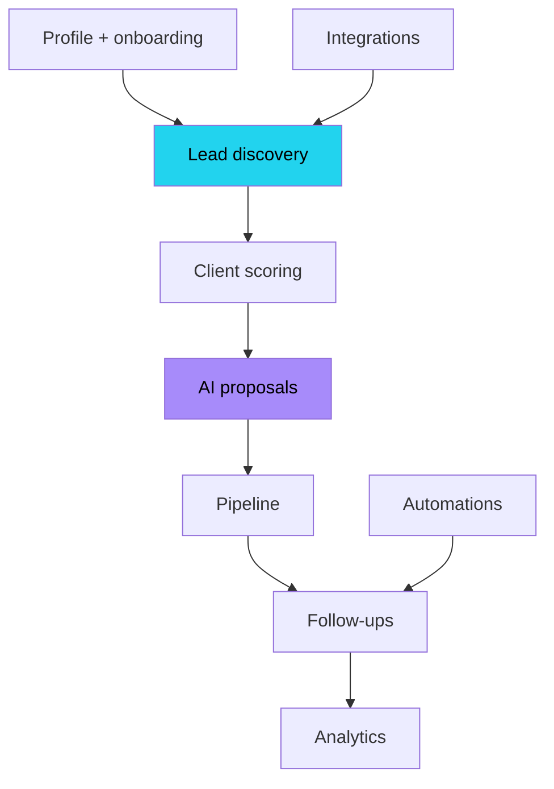

<div align="center">



      


[**Live demo**](https://clinq-delta.vercel.app) · [Product brief](BRD.md) · [Design system docs](design_system_docs)

</div>

---

## The idea

Freelancers juggle lead sources, proposal writing, follow-ups and client tracking across a dozen tabs. Clinq puts them in one place: connect your profiles, discover leads, generate tailored AI proposals, track every deal through a pipeline, and let automations handle the follow-ups.

> Status: active development. The long-term goal is to grow from a personal productivity system into a SaaS for freelancers, agencies and teams.

## Modules



| Module | What it does |
|---|---|
| 🎯 **Leads** | Collect and organize opportunities from your connected platforms |
| ✍️ **Proposals** | OpenAI-powered proposal drafts tailored to the lead and your profile |
| 🧭 **Pipeline** | Kanban-style deal tracking from lead to won |
| ⏰ **Follow-ups** | Never lose a warm lead; reminders and templates |
| ⚙️ **Automations** | Rules that run the repetitive parts of your workflow |
| 🔌 **Integrations** | Connect the platforms you already use |
| 📈 **Analytics** | Charts for conversion, response and revenue trends |

## Stack


Next.js 15 (App Router, Turbopack) · React 19 · TypeScript · Tailwind · shadcn/ui · Supabase (Postgres, Auth) · OpenAI · Recharts · Jest · Playwright

## Getting started

```bash
npm install
cp .env.example .env.local   # Supabase + OpenAI keys
npm run dev                  # http://localhost:3000
npm test
```

## Built by

[Yash Bankar](https://github.com/yashbank), at Crestline Technologies, in personal time, with AI agents under human-owned architecture and review.
